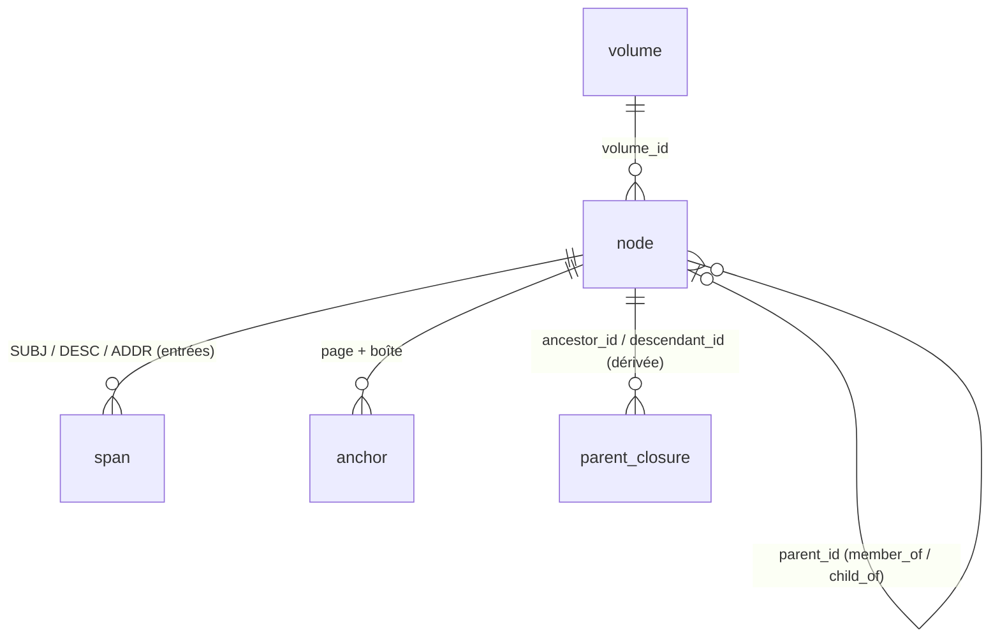

# Modèle de données — v2

État : schéma et import implémentés ; requêtes de la section 3 implémentées pour le scénario du sous-arbre (`lib/query/`). Décisions : `docs/DECISIONS.md`. Extensions
prévues (géocodage, liens temporels) : fin de document.

Sources : `data/<volume>/` (`<volume>.document.json`,
`<volume>.structure.json`, `volume.json`), hors Git.

Principes retenus :
- **numrev fait foi** : l'application importe l'export tel quel, sans
  rattrapage. Les défauts de données se corrigent dans numrev.
- **Schéma minimal et commun** : sections, entrées et éléments hors champ
  sont des nœuds d'une même table, traités de la même manière.
- **Un seul annuaire** pour commencer ; pas de liens temporels.

## 1. Les données sources

Format de référence : `../adresses_revolutionnaires/docs/format_export.md`
(`numrev-document/1`, `numrev-structure/2`). Fichiers de 1807 (10,8 + 18,1 Mo).

| Fichier | Objet | Nombre | Repris dans le modèle |
|---|---|---|---|
| `structure.json` | titre (section) | 603 | `id`, `parent`, `heading` ; position dans la liste |
| | entrée | 20 709 | `id`, `parent`, `text`, `spans` ; position dans la liste |
| | élément hors champ (titre courant, numéro de page, note, texte libre ; une ligne chacun) | 846 | `id`, `parent`, `text` ; position dans la liste |
| | empan | 45 673 (SUBJ 20 863, ADDR 19 980, DESC 4 830) | `id`, `label`, `start`, `end`, `normalized` |
| `document.json` | page | 250 objets (248 pages du PDF) | numéro de page (via les lignes) |
| | ligne | 22 625 (dont 219 `SUPPRIMÉE`) | `bbox_estimate` des lignes d'un nœud (union par page) ; ordre des lignes = ordre de lecture |
| `volume.json` (à la main) | métadonnées Dublin Core | 1 | `identifier`, `title`, `temporal` |

Non repris : plages, blocs, mots et confiances OCR, `level` des titres,
`kind` et `members` des entrées (groupes à accolade), `quality`, `pieces`
des empans, provenance.

Observations à remonter à numrev (l'application ne les corrige pas) :
- 51 entrées et quelques titres n'ont aucune ligne boîtée : **pas d'ancre**
  pour eux ;
- 19 entrées simples contiennent plusieurs SUBJ ;
- 197 renvois « voyez » non structurés ;
- 89 éléments hors champ sans ligne boîtée : pas d'ancre non plus ;
- la nature d'un élément hors champ (titre courant, numéro, texte) n'est pas
  exportée : numrev ne la connaît pas (seul indice : le libellé OCR du bloc,
  non relu, non repris ici).

Les pages partagées par deux plages (p. 192 et 212) sont réglées dans numrev
(partie de l'autre plage `SUPPRIMÉE`) : pas de doublon dans `structure.json`.
Demande d'origine : `docs/demandes/numrev_hors_champ.md`.

## 2. Modèle

### Tables

| Table | Rôle | Lignes (1807) |
|---|---|---|
| `volume` | l'annuaire : identifiant, titre, intervalle temporel | 1 |
| `node` | **nœud** typé `entry`, `section` ou `out_of_scope` | 22 158 |
| `span` | champs structurés d'une entrée : SUBJ / DESC / ADDR | 45 673 |
| `anchor` | ancrage d'un nœud : page du PDF et boîte, une ligne par page touchée | 22 017 |
| `parent_closure` | fermeture des nœuds parents : (ancêtre, descendant), dérivée de `parent_id` | 1 515 |

`parent_closure` n'apporte aucune information : elle range autrement
`parent_id` pour lire un sous-arbre sans parcours récursif. Une ligne relie
chaque nœud qui a des enfants à lui-même et à chacun de ses ancêtres ;
dans numrev ce sont exactement les sections (602 sur 603 ont des enfants),
mais rien n'y suppose le type du nœud ni l'ordre de lecture. Le sous-arbre
d'un nœud X : X, plus les enfants des nœuds `descendant_id` des lignes
où `ancestor_id = X`.

Pas de table `page` : un numéro de page du PDF suffit pour ancrer (les
boîtes sont dans un repère relatif 0–1000) et désignera plus tard la toile
IIIF. La taille de l'image viendra du serveur IIIF.

### Arcs

| Arc | Entre | Stockage |
|---|---|---|
| `member_of` | entrée ou élément hors champ → section | `node.parent_id` d'une entrée ou d'un élément hors champ |
| `child_of` | section → section | `node.parent_id` d'une section |
| `follows` | entrée → entrée suivante dans l'ordre de lecture du volume, à travers les sections, sans compter les autres nœuds | `node.next_entry_id` d'une entrée (null pour la dernière), calculé à l'import |

Les trois arcs suivent le même principe : une colonne de `node` pointe vers
le nœud cible (clé étrangère). `next_entry_id` est déduit à l'import de
l'ordre de lecture (première entrée de rang supérieur) ; l'import insère
les nœuds d'un volume en une seule instruction pour que sa clé étrangère,
vers une entrée plus loin dans l'ordre, soit vérifiée en fin d'instruction.

`member_of` et `child_of` sont la même colonne : numrev donne un seul arbre
(champ `parent`) où tous les objets ont pour parent un titre (ou la racine).
Un élément hors champ est rangé sous la rubrique ouverte à cet endroit : un
titre courant « appartient » ainsi à la rubrique en cours, au sens de
l'ordre de lecture et non du contenu. Le type
d'arc se lit au type du nœud source. Aucune table d'arcs : tout est porté
par des colonnes.

**Ordre de lecture et succession sont distincts.** L'ordre de lecture est un
attribut commun à tous les nœuds (`document_reading_order`, rang 0…n-1 dans
le volume, tous types confondus) : une vue qui parcourt le document trie
par lui, sans passer par un arc. `follows` est une relation entre entrées
seulement (« l'entrée suivante ») ; elle saute les sections et les éléments
hors champ. Stockée, elle se recalcule à chaque import : un nouveau type de
nœud ou une autre définition de « suivante » ne demande que de modifier son
calcul dans `scripts/rows.ts`.

### Diagramme



### Schéma Drizzle

Source de vérité : `lib/db/schema.ts` (commenté), appliqué par
`pnpm db:push` (`drizzle-kit push`, sans migrations). Noms de colonnes SQL
explicites en snake_case. Les extensions `pg_trgm` et `unaccent`, et la
fonction `immutable_unaccent` (enveloppe `IMMUTABLE` de `unaccent`, exigée
pour l'indexer), sont créées par `lib/db/init.sql` à la création de la
base Docker, pas par Drizzle. L'image PostGIS crée en plus ses propres
extensions (`postgis`, `postgis_topology`, `postgis_tiger_geocoder`,
`fuzzystrmatch`), inutilisées pour l'instant.

Types retenus : boîtes d'ancre en `real` (le schéma numrev les déclare
`number`), positions d'empan en `integer`, dates de l'intervalle en `date`.

### Import (`scripts/`)

- `node` : les `titles`, les `entries` et les `out_of_scope` du `structure.json` ;
  `document_reading_order` = rang de leur première ligne dans l'ordre des
  lignes de `document.json` (ordre de lecture du volume) ; `parent_id` =
  `parent`, sauf la racine numrev → `null` ; `next_entry_id` = entrée
  suivante dans cet ordre (entrées seulement). Tous les nœuds du volume en
  une instruction (`jsonb_to_recordset`), dans l'ordre de lecture.
- `parent_closure` : calculée des `parent_id` (`parentClosureOf`) ; une
  boucle dans les parents arrête l'import.
- `anchor` : pour chaque nœud et chaque page, union des `bbox_estimate` non
  nulles de ses lignes ; aucune ligne boîtée sur la page → pas d'ancre.
- `volume` : `data/<volume>/volume.json`.
- Avant tout : validation des trois fichiers (`scripts/validate.ts`) contre
  les JSON Schema de numrev (copiés dans `scripts/schemas/`) et contre
  `scripts/schemas/volume.schema.json` ; les trois doivent nommer le même
  volume. Un fichier non conforme arrête l'import.
- Le volume est remplacé en entier, dans une transaction.

Résultat pour 1807 : 22 158 nœuds (603 sections, 20 709 entrées, 846
éléments hors champ), 1 515 lignes de fermeture, 45 673 empans, 22 017
ancres ; 51 entrées, 3 sections
et 89 éléments hors champ sans ancre ; 2 entrées ancrées sur deux pages.

### Choix discutables ⚠️

1. **Une seule table `node`** : `text` change de source selon le type
   (`heading` pour une section) ; rien en base n'empêche un empan sur une
   section ou un élément hors champ, ni une entrée parente d'une entrée
   (numrev fait foi).
2. **Hors champ en `member_of`** : même arc que les entrées vers leur
   rubrique ; un sous-graphe « toute la rubrique » les inclut donc, sauf
   filtre `kind = 'entry'`.
3. **`follows` stocké** (`node.next_entry_id`) : donnée dérivée de l'ordre
   de lecture, calculée à l'import, comme `parent_closure` (point 7) ; les
   trois arcs sont ainsi portés par des colonnes. Clé étrangère sans
   cascade : supprimer une entrée seule est refusé tant qu'une autre la
   désigne. Décidé le 18 novembre, après mesure des requêtes de
   `lib/query/` (calculé, il pesait la moitié du temps des gros
   sous-arbres).
4. **Pas de `page`**, pas de taille d'image : à revoir avec IIIF.
5. **Ordre alphabétique** : sur le premier SUBJ (`min(char_start)`), par
   sous-requête, sans colonne dénormalisée.
6. **Géocodage** : pas de table, sprint dédié (voir « Plus tard ») ; les
   empans ADDR et leur uuid en sont le point d'accroche.
7. **`parent_closure`, donnée dérivée** : redondante avec `parent_id`, tenue
   à jour par l'import seul (le volume est remplacé en entier, la table
   suit en cascade) ; aucune écriture ailleurs ne doit modifier `parent_id`
   sans la recalculer. Même règle pour `next_entry_id` et l'ordre de
   lecture.

## 3. Requête → sous-graphe induit (SQL)

Implémenté dans `lib/query/` pour les scénarios de `docs/SCENARIOS.md`.
Une seule sélection SQL par requête (`selection` dans `resolve.ts`) : elle
rend les nœuds sélectionnés avec leurs colonnes d'arcs (`parent_id`,
`next_entry_id`). Elle est lue en trois requêtes parallèles, en lignes
simples : les nœuds, leurs empans, leurs ancres, rattachés ensuite en
TypeScript (section 4) ; les arcs de l'étape 2 sont déduits des lignes des
nœuds (`inducedArcs`). Le sous-arbre est lu dans `parent_closure`, sans
`WITH RECURSIVE`. À part : le contexte de la sélection (`context`, ses
rubriques ancêtres) et les facettes (`facets.ts`, volumes et rubriques avec
leurs décomptes). Les types rendus sont dans `types.ts`.

Les formes ci-dessous restent la référence pour les filtres à venir ; un
parcours récursif s'y remplace par `parent_closure`.

### Étape 1 : les nœuds (seule partie qui dépend de la requête)

Exemple : les entrées de la rubrique BOULANGERS et de ses sous-rubriques
dont un nom ressemble à « Lefevre », dans une période.

```sql
WITH
subtree AS (                       -- la section et tous ses descendants
  SELECT :section AS id
  UNION ALL
  SELECT n.id FROM parent_closure c JOIN node n ON n.parent_id = c.descendant_id
  WHERE c.ancestor_id = :section
),
nodes AS (
  SELECT n.id
  FROM node n
  JOIN volume v ON v.id = n.volume_id
  WHERE n.kind = 'entry'
    AND n.id IN (SELECT id FROM subtree)
    AND v.temporal_end >= :from AND v.temporal_start <= :to         -- période
    AND EXISTS (                                                     -- champ, tolérant aux fautes et aux accents
      SELECT 1 FROM span s
      WHERE s.node_id = n.id AND s.label = 'SUBJ'
        AND immutable_unaccent(:name) <% immutable_unaccent(s.normalized)
    )
)
SELECT id FROM nodes;
```

Autres sélections : des sections (`kind = 'section' AND immutable_unaccent(text) % immutable_unaccent('boulangers')`),
une fiche (`id = :id`), tout l'annuaire (`volume_id = :v`).

### Étape 2 : les arcs (code fixe, ne dépend que des nœuds)

```sql
-- member_of / child_of : le parent, si les deux bouts sont sélectionnés
SELECT n.id AS source, n.parent_id AS target,
       CASE n.kind WHEN 'section' THEN 'child_of' ELSE 'member_of' END AS kind
FROM node n
WHERE n.id IN (SELECT id FROM nodes)
  AND n.parent_id IN (SELECT id FROM nodes);

-- follows : l'entrée suivante, si les deux sont sélectionnées
SELECT n.id AS source, n.next_entry_id AS target, 'follows' AS kind
FROM node n
WHERE n.id IN (SELECT id FROM nodes)
  AND n.next_entry_id IN (SELECT id FROM nodes);
```

Dans `lib/query/`, ces deux formes sont appliquées en TypeScript
(`inducedArcs`) aux lignes déjà lues, qui portent `parent_id` et
`next_entry_id`.

### Étape 3 : étendre par les liens documentaires

Chaque extension rend un nouvel ensemble de nœuds ; les arcs se recalculent
par l'étape 2.

```sql
-- sections parentes (un pas)
SELECT id FROM nodes
UNION SELECT parent_id FROM node WHERE id IN (SELECT id FROM nodes) AND parent_id IS NOT NULL;

-- toutes les sections ancêtres (celles du parent de chaque nœud)
SELECT id FROM nodes
UNION
SELECT c.ancestor_id FROM node n JOIN parent_closure c ON c.descendant_id = n.parent_id
WHERE n.id IN (SELECT id FROM nodes);

-- contenu des sections sélectionnées (tous les descendants)
SELECT id FROM nodes
UNION
SELECT n.id FROM parent_closure c JOIN node n ON n.parent_id = c.descendant_id
WHERE c.ancestor_id IN (SELECT id FROM nodes);

-- entrées voisines dans le texte (suivante et précédente, par follows)
SELECT id FROM nodes
UNION
SELECT next_entry_id FROM node WHERE id IN (SELECT id FROM nodes) AND next_entry_id IS NOT NULL
UNION
SELECT id FROM node WHERE next_entry_id IN (SELECT id FROM nodes);   -- index node (next_entry_id)
```

## 4. Performances en lecture

Toute la base de 1807 tient en mémoire (62 Mo, `shared_buffers` 128 Mo).

**Index** (`lib/db/schema.ts`) :

| Index | Sert à |
|---|---|
| `node (volume_id, document_reading_order)` unique | vue document : une plage de rangs |
| `node (next_entry_id)` | entrée précédente ; vérification de la clé étrangère à la suppression |
| `node (parent_id)` | enfants d'une section, sous-arbre (avec `parent_closure`) |
| `parent_closure (ancestor_id, descendant_id)` PK, `parent_closure (descendant_id)` | nœuds parents d'un sous-arbre ; ancêtres d'un nœud et suppression en cascade |
| `anchor (node_id, page)` PK, `anchor (page)` | ancres d'un nœud, nœuds d'une page |
| `span (node_id)` | empans d'une entrée |
| GIN trigrammes sur `immutable_unaccent(node.text)` : un général + un partiel par `kind` | recherche floue sans accents ; le partiel sert quand la requête fixe `kind = '<littéral>'` |
| idem sur `immutable_unaccent(span.normalized)` : un général + un partiel par `label` | idem, avec `label = '<littéral>'` |

**Règles pour écrire les requêtes** :
- fixer `kind` et `label` par un littéral (ou un paramètre de requête
  préparée) pour que l'index partiel serve ;
- écrire l'expression indexée telle quelle (`immutable_unaccent(...)`) ;
- sous-arbre : `parent_closure`, et `UNION ALL` plutôt qu'un `OR` entre le
  nœud et ses descendants (un `OR` relit toute la table).

**Côté serveur** :
- `VACUUM (ANALYZE)` après chaque import (`scripts/import.ts`) :
  statistiques à jour, et carte de visibilité remplie pour les parcours
  d'index seul ;
- `jit=off` et `random_page_cost=1.1` (`compose.yaml`) ;
- nœuds insérés dans l'ordre de lecture : la vue document lit des pages
  contiguës.

**Mesures** (1807, cache chaud, temps d'exécution ; 30 octobre, quand
`follows` était encore calculé : les lignes « arcs » ne valent plus pour
les formes actuelles de l'étape 2) :

| Requête | Avant | Après |
|---|---|---|
| sections ~ « boulangers » | 8,3 ms | 0,3 ms |
| SUBJ ~ « Lefevre », tout le volume | 1,2 ms | 0,6 ms |
| sous-arbre de VINS + SUBJ ~ « Lefevre » | 12,7 ms | 4,4 ms |
| ADDR ~ « rue de la Paix » (1 648 résultats) | 15,5 ms | 15,5 ms |
| arcs de la plus grosse rubrique (3 337 enfants) | 49,7 ms | 29,3 ms |
| arcs de tout le volume (22 158 nœuds) | 213,9 ms | 97,8 ms ; 22,3 ms pour `follows` par `lead()` |
| vue document (une page, 100 rangs), fiche | < 0,4 ms | < 0,3 ms |

**`resolve` (scénario 1, sous-arbre)** : sous-arbre lu dans
`parent_closure`, arcs lus dans `parent_id` et `next_entry_id`.

| Sous-arbre | Nœuds | SQL | Depuis Node, arcs compris |
|---|---|---|---|
| une entrée | 1 | 0,016 ms | — |
| petite rubrique | ≈ 30 | 0,13 ms | — |
| LISTE DE NON-COMMERÇANS | 3 338 | 1,5 ms | 7,7 ms |
| LISTES PARTICULIÈRES (62 % du volume) | 13 737 | 7,6 ms | 35 ms |

Étapes (SQL seul, petite rubrique ; plus gros sous-arbre) :
- parcours récursif et une sous-requête d'entrée suivante par entrée :
  1,4 ms ; 70 à 80 ms ;
- parcours récursif et `lead()` sur la plage du sous-arbre : 1,0 ms ; 38 ms ;
- `parent_closure` et `lead()` sur la plage : 0,39 ms ; 19,5 ms ;
- `parent_closure` et `next_entry_id` stocké (retenu) : 0,13 ms ; 7,6 ms.

Écartés : `lead()` sur toutes les entrées du volume (16 ms ; 49 ms) ; un
`OR` entre le nœud et ses descendants au lieu de `UNION ALL` (relit toute
la table : 2,4 ms pour une petite rubrique). Toutes les formes donnent des
sous-graphes identiques sur les 603 rubriques de 1807 et 200 autres nœuds.

Sur le plus gros sous-arbre, vu de Node, il reste ≈ 15 ms de transfert et
de lecture des 13 737 lignes par postgres.js (inhérent au volume : seule
une réponse plus petite, paginée par exemple, le réduirait) et ≈ 6 ms de
TypeScript (nœuds et arcs). Construire le JSON dans PostgreSQL
(`json_agg`) est plus lent : 41 ms contre 16 pour les mêmes lignes.

**Empans et ancres des nœuds** (sprint 4) : `resolve` les renvoie avec
chaque nœud. Trois requêtes en parallèle, qui sélectionnent chacune le
sous-arbre de la même façon puis lisent les nœuds, leurs empans et leurs
ancres en lignes simples, rattachées ensuite en TypeScript. Temps médian
vu de Node (18 novembre) :

| Écriture | Petite rubrique | 3 338 nœuds | 13 737 nœuds |
|---|---|---|---|
| sans empans ni ancres (référence) | 0,35 ms | 7,6 ms | 27 ms |
| une requête, JSON par nœud (`json_agg`) | 1,0 ms | 45 ms | 192 ms |
| une requête, tableaux par nœud (`array_agg`) | 1,1 ms | 44 ms | 177 ms |
| une requête, lignes simples étiquetées (nœud, empan, ancre) | 0,7 ms | 28 ms | 123 ms |
| trois requêtes, lignes simples (retenu) | 0,8 ms | 21 ms | 90 ms |

Regrouper par nœud dans PostgreSQL, en JSON ou en tableaux, coûte à lui
seul ≈ 150 ms d'exécution sur le plus gros sous-arbre. Les quatre écritures
donnent des sous-graphes identiques sur les 603 rubriques et 200 autres
nœuds. Contexte (rubriques ancêtres, `context`) : 0,1 ms.

Pistes non retenues (elles changent le modèle) : `docs/IDEES.md`.

## Plus tard : géocodage (sprint dédié)

- Résultat rattaché à l'uuid d'un empan ADDR (géométrie, score, méthode),
  dans une table à part ; index GiST pour le filtre par zone
  (`geom && ST_MakeEnvelope(...)`).
- À trancher alors : point seul ou géométrie de voie pour les adresses sans
  numéro (1 130 en 1807).

## Plus tard : liens temporels (sprint dédié)

- Arcs entre entrées d'éditions successives, importés de la jointure numrev
  `<A>__<B>.<méthode>.join.csv` (`methode`, `certitude`,
  `niveau_incertitude`, `score`).
- Appariement des rubriques entre éditions (numrev `alignment/sections.py`,
  cas 1-N) : arcs temporels entre sections.
- Composante (lignée) par parcours non orienté jusqu'au point fixe :

```sql
WITH RECURSIVE
edge(a, b) AS (SELECT source_id, target_id FROM link UNION ALL SELECT target_id, source_id FROM link),
component(id) AS (
  SELECT id FROM nodes
  UNION                            -- UNION : écarte les doublons, s'arrête sur les cycles
  SELECT e.b FROM component c JOIN edge e ON e.a = c.id
)
SELECT id FROM component;
```
