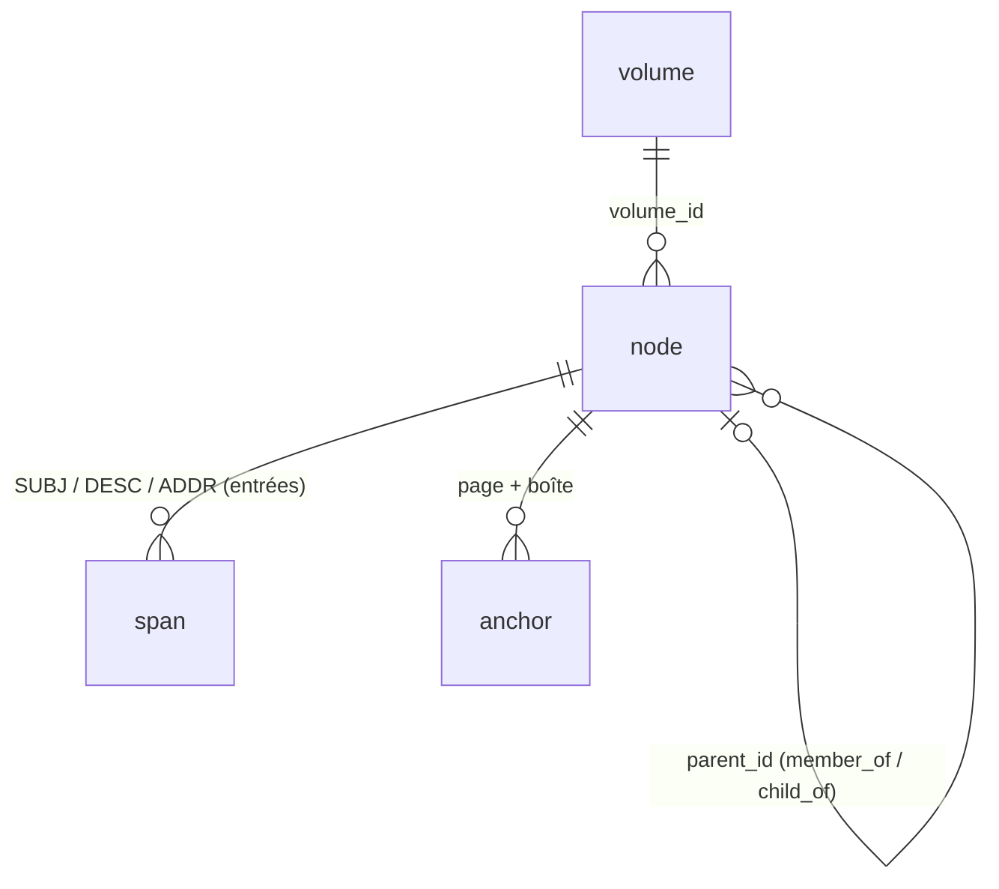

# Modèle de données — v2

État : rien n'est implémenté. Décisions : `docs/DECISIONS.md`. Extensions
prévues (géocodage, liens temporels) : fin de document.

Sources : `data/<volume>/` (`<volume>.document.json`,
`<volume>.structure.json`, `volume.json`), hors Git.

Principes retenus :
- **numrev fait foi** : l'application importe l'export tel quel, sans
  rattrapage. Les défauts de données se corrigent dans numrev.
- **Schéma minimal et commun** : sections et entrées sont des nœuds d'une
  même table, traités de la même manière.
- **Un seul annuaire** pour commencer ; pas de liens temporels.

## 1. Les données sources

Format de référence : `../adresses_revolutionnaires/docs/format_export.md`
(`numrev-document/1`, `numrev-structure/1`). Fichiers de 1807 (10,8 + 17,9 Mo).

| Fichier | Objet | Nombre | Repris dans le modèle |
|---|---|---|---|
| `structure.json` | titre (section) | 603 | `id`, `parent`, `heading` ; position dans la liste |
| | entrée | 20 709 | `id`, `parent`, `text`, `spans` ; position dans la liste |
| | empan | 45 673 (SUBJ 20 863, ADDR 19 980, DESC 4 830) | `id`, `label`, `start`, `end`, `normalized` |
| `document.json` | page | 250 objets (248 pages du PDF) | numéro de page (via les lignes) |
| | ligne | 22 625 | `bbox_estimate` des lignes d'un nœud (union par page) |
| `volume.json` (à la main) | métadonnées Dublin Core | 1 | `identifier`, `title`, `temporal` |

Non repris : plages, blocs, mots et confiances OCR, `level` des titres,
`kind` et `members` des entrées (groupes à accolade), `quality`, `pieces`
des empans, provenance.

Observations à remonter à numrev (l'application ne les corrige pas) :
- 51 entrées et quelques titres n'ont aucune ligne boîtée : **pas d'ancre**
  pour eux ;
- 19 entrées simples contiennent plusieurs SUBJ ;
- 197 renvois « voyez » non structurés ;
- p. 192 et 212 lues dans deux plages (sans effet ici : seules les lignes
  rattachées à un nœud sont lues).

## 2. Modèle

### Tables

| Table | Rôle | Lignes (1807) |
|---|---|---|
| `volume` | l'annuaire : identifiant, titre, intervalle temporel | 1 |
| `node` | **nœud** typé `entry` ou `section` | 21 312 |
| `span` | champs structurés d'une entrée : SUBJ / DESC / ADDR | 45 673 |
| `anchor` | ancrage d'un nœud : page du PDF et boîte, une ligne par page touchée | ≈ 21 250 |

Pas de table `page` : un numéro de page du PDF suffit pour ancrer (les
boîtes sont dans un repère relatif 0–1000) et désignera plus tard la toile
IIIF. La taille de l'image viendra du serveur IIIF.

### Arcs

| Arc | Entre | Stockage |
|---|---|---|
| `member_of` | entrée → section | `node.parent_id` d'une entrée |
| `child_of` | section → section | `node.parent_id` d'une section |
| `follows` | entrée → entrée suivante dans l'ordre de lecture du volume, à travers les sections | `node.rank` des entrées : `b.rank = a.rank + 1` |

`member_of` et `child_of` sont la même colonne : numrev donne un seul arbre
(champ `parent`) où entrées et titres ont pour parent un titre. Le type
d'arc se lit au type du nœud source. Aucune table d'arcs : tout est déduit
des colonnes.

### Diagramme



### Schéma Drizzle (`lib/db/schema.ts`, proposé)

Avec `casing: "snake_case"` dans la configuration Drizzle. Les extensions
`pg_trgm` et `unaccent`, et la fonction `immutable_unaccent` (enveloppe
`IMMUTABLE` de `unaccent`, exigée pour l'indexer), sont créées par le
script d'initialisation de la base Docker, pas par Drizzle.

```ts
import { sql } from "drizzle-orm";
import {
  check, date, foreignKey, index, integer, pgEnum, pgTable, primaryKey,
  smallint, text, unique, uuid,
} from "drizzle-orm/pg-core";

export const nodeKind = pgEnum("node_kind", ["entry", "section"]);
export const spanLabel = pgEnum("span_label", ["SUBJ", "DESC", "ADDR"]);

/** Annuaire, décrit par data/<volume>/volume.json (Dublin Core). */
export const volume = pgTable(
  "volume",
  {
    id: text().primaryKey(), // dc:identifier = nom du volume numrev, ex. « 1807_AD75-PER292 »
    title: text(), // dc:title ; null tant qu'il n'est pas renseigné
    temporalStart: date().notNull(), // dcterms:temporal, début (AAAA-MM-JJ)
    temporalEnd: date().notNull(), // dcterms:temporal, fin (AAAA-MM-JJ)
  },
  (t) => [check("volume_temporal", sql`${t.temporalStart} <= ${t.temporalEnd}`)],
);

/** Nœud du graphe : une entrée ou une section (titre) de l'annuaire. */
export const node = pgTable(
  "node",
  {
    id: uuid().primaryKey(), // uuid numrev de l'entrée ou du titre
    volumeId: text().notNull().references(() => volume.id, { onDelete: "cascade" }),
    kind: nodeKind().notNull(),
    parentId: uuid(), // section parente : arc member_of (entrée) ou child_of (section) ; null = racine
    rank: integer().notNull(), // position dans la liste numrev de son type ; entrées : arc follows
    text: text().notNull(), // entrée : « text » ; section : « heading »
  },
  (t) => [
    foreignKey({ columns: [t.parentId], foreignColumns: [t.id] }).onDelete("cascade"),
    unique().on(t.volumeId, t.kind, t.rank),
    index().on(t.parentId),
    index("node_text_trgm").using("gin", sql`immutable_unaccent(${t.text}) gin_trgm_ops`),
  ],
);

/** Champ structuré d'une entrée : empan SUBJ (qui), DESC (quoi) ou ADDR (où). */
export const span = pgTable(
  "span",
  {
    id: uuid().primaryKey(), // uuid numrev de l'empan (futur point d'accroche du géocodage)
    nodeId: uuid().notNull().references(() => node.id, { onDelete: "cascade" }),
    label: spanLabel().notNull(),
    charStart: smallint().notNull(), // position dans node.text, en points de code (fin exclue)
    charEnd: smallint().notNull(),
    normalized: text().notNull(), // texte sans emphase, blancs réduits (numrev)
  },
  (t) => [
    index().on(t.nodeId),
    index("span_normalized_trgm").using("gin", sql`immutable_unaccent(${t.normalized}) gin_trgm_ops`),
  ],
);

/** Ancrage d'un nœud dans la source : sa boîte sur une page du PDF. */
export const anchor = pgTable(
  "anchor",
  {
    nodeId: uuid().notNull().references(() => node.id, { onDelete: "cascade" }),
    page: smallint().notNull(), // page du PDF, à partir de 1
    // union des boîtes de ses lignes sur cette page ; repère numrev 0–1000, origine en haut à gauche
    x0: smallint().notNull(),
    y0: smallint().notNull(),
    x1: smallint().notNull(),
    y1: smallint().notNull(),
  },
  (t) => [primaryKey({ columns: [t.nodeId, t.page] }), index().on(t.page)],
);
```

### Import (`scripts/`, pour mémoire)

- `node` : les `titles` puis les `entries` du `structure.json` ; `rank` =
  position dans leur liste (numrev les donne dans l'ordre du document) ;
  `parent_id` = `parent`, sauf la racine numrev → `null`.
- `anchor` : pour chaque nœud et chaque page, union des `bbox_estimate` non
  nulles de ses lignes ; aucune ligne boîtée sur la page → pas d'ancre.
- `volume` : `data/<volume>/volume.json`.

### Choix discutables ⚠️

1. **Une seule table `node`** : `text` change de source selon le type
   (`heading` pour une section) ; rien en base n'empêche un empan sur une
   section ou une entrée parente d'une entrée (numrev fait foi).
2. **`rank` par type** : titres et entrées ont chacun leur numérotation.
   Suffisant pour `follows` (entrées seulement) et pour trier chaque type ;
   ne donne pas l'intercalage titres/entrées.
3. **Pas de `page`**, pas de taille d'image : à revoir avec IIIF.
4. **Ordre alphabétique** : sur le premier SUBJ (`min(char_start)`), par
   sous-requête, sans colonne dénormalisée.
5. **Géocodage** : pas de table, sprint dédié (voir « Plus tard ») ; les
   empans ADDR et leur uuid en sont le point d'accroche.

## 3. Requête → sous-graphe induit (SQL)

### Étape 1 : les nœuds (seule partie qui dépend de la requête)

Exemple : les entrées de la rubrique BOULANGERS et de ses sous-rubriques
dont un nom ressemble à « Lefevre », dans une période.

```sql
WITH RECURSIVE
subtree AS (                       -- la section et tous ses descendants
  SELECT id FROM node WHERE id = :section
  UNION ALL
  SELECT n.id FROM node n JOIN subtree t ON n.parent_id = t.id
),
nodes AS (
  SELECT n.id
  FROM node n
  JOIN volume v ON v.id = n.volume_id
  WHERE n.kind = 'entry'
    AND n.id IN (SELECT id FROM subtree)
    AND v.temporal_end >= :from AND v.temporal_start <= :to         -- période
    AND EXISTS (                                                     -- champ, tolérant aux fautes et aux accents
      SELECT 1 FROM span s
      WHERE s.node_id = n.id AND s.label = 'SUBJ'
        AND immutable_unaccent(:name) <% immutable_unaccent(s.normalized)
    )
)
SELECT id FROM nodes;
```

Autres sélections : des sections (`kind = 'section' AND immutable_unaccent(text) % immutable_unaccent('boulangers')`),
une fiche (`id = :id`), tout l'annuaire (`volume_id = :v`).

### Étape 2 : les arcs (code fixe, ne dépend que des nœuds)

```sql
-- member_of / child_of : le parent, si les deux bouts sont sélectionnés
SELECT n.id AS source, n.parent_id AS target,
       CASE n.kind WHEN 'entry' THEN 'member_of' ELSE 'child_of' END AS kind
FROM node n
WHERE n.id IN (SELECT id FROM nodes)
  AND n.parent_id IN (SELECT id FROM nodes);

-- follows : entrées consécutives, si les deux sont sélectionnées
SELECT a.id AS source, b.id AS target, 'follows' AS kind
FROM node a
JOIN node b ON b.volume_id = a.volume_id AND b.kind = 'entry' AND b.rank = a.rank + 1
WHERE a.kind = 'entry'
  AND a.id IN (SELECT id FROM nodes)
  AND b.id IN (SELECT id FROM nodes);
```

### Étape 3 : étendre par les liens documentaires

Chaque extension rend un nouvel ensemble de nœuds ; les arcs se recalculent
par l'étape 2.

```sql
-- sections parentes (un pas)
SELECT id FROM nodes
UNION SELECT parent_id FROM node WHERE id IN (SELECT id FROM nodes) AND parent_id IS NOT NULL;

-- toutes les sections ancêtres
WITH RECURSIVE up(id) AS (
  SELECT id FROM nodes
  UNION
  SELECT n.parent_id FROM node n JOIN up ON n.id = up.id WHERE n.parent_id IS NOT NULL
)
SELECT id FROM up;

-- contenu des sections sélectionnées (tous les descendants)
WITH RECURSIVE down(id) AS (
  SELECT id FROM nodes
  UNION
  SELECT n.id FROM node n JOIN down ON n.parent_id = down.id
)
SELECT id FROM down;

-- entrées voisines dans le texte (précédente et suivante)
SELECT id FROM nodes
UNION
SELECT b.id FROM node a
JOIN node b ON b.volume_id = a.volume_id AND b.kind = 'entry' AND b.rank IN (a.rank - 1, a.rank + 1)
WHERE a.kind = 'entry' AND a.id IN (SELECT id FROM nodes);
```

## Plus tard : géocodage (sprint dédié)

- Résultat rattaché à l'uuid d'un empan ADDR (géométrie, score, méthode),
  dans une table à part ; index GiST pour le filtre par zone
  (`geom && ST_MakeEnvelope(...)`).
- À trancher alors : point seul ou géométrie de voie pour les adresses sans
  numéro (1 130 en 1807).

## Plus tard : liens temporels (sprint dédié)

- Arcs entre entrées d'éditions successives, importés de la jointure numrev
  `<A>__<B>.<méthode>.join.csv` (`methode`, `certitude`,
  `niveau_incertitude`, `score`).
- Appariement des rubriques entre éditions (numrev `alignment/sections.py`,
  cas 1-N) : arcs temporels entre sections.
- Composante (lignée) par parcours non orienté jusqu'au point fixe :

```sql
WITH RECURSIVE
edge(a, b) AS (SELECT source_id, target_id FROM link UNION ALL SELECT target_id, source_id FROM link),
component(id) AS (
  SELECT id FROM nodes
  UNION                            -- UNION : écarte les doublons, s'arrête sur les cycles
  SELECT e.b FROM component c JOIN edge e ON e.a = c.id
)
SELECT id FROM component;
```
