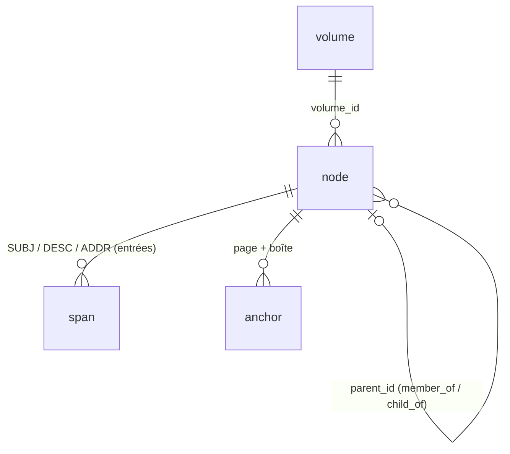

# Modèle de données — v2

État : schéma et import implémentés ; requêtes de la section 3 non implémentées. Décisions : `docs/DECISIONS.md`. Extensions
prévues (géocodage, liens temporels) : fin de document.

Sources : `data/<volume>/` (`<volume>.document.json`,
`<volume>.structure.json`, `volume.json`), hors Git.

Principes retenus :
- **numrev fait foi** : l'application importe l'export tel quel, sans
  rattrapage. Les défauts de données se corrigent dans numrev.
- **Schéma minimal et commun** : sections, entrées et éléments hors champ
  sont des nœuds d'une même table, traités de la même manière.
- **Un seul annuaire** pour commencer ; pas de liens temporels.

## 1. Les données sources

Format de référence : `../adresses_revolutionnaires/docs/format_export.md`
(`numrev-document/1`, `numrev-structure/2`). Fichiers de 1807 (10,8 + 18,1 Mo).

| Fichier | Objet | Nombre | Repris dans le modèle |
|---|---|---|---|
| `structure.json` | titre (section) | 603 | `id`, `parent`, `heading` ; position dans la liste |
| | entrée | 20 709 | `id`, `parent`, `text`, `spans` ; position dans la liste |
| | élément hors champ (titre courant, numéro de page, note, texte libre ; une ligne chacun) | 846 | `id`, `parent`, `text` ; position dans la liste |
| | empan | 45 673 (SUBJ 20 863, ADDR 19 980, DESC 4 830) | `id`, `label`, `start`, `end`, `normalized` |
| `document.json` | page | 250 objets (248 pages du PDF) | numéro de page (via les lignes) |
| | ligne | 22 625 (dont 219 `SUPPRIMÉE`) | `bbox_estimate` des lignes d'un nœud (union par page) ; ordre des lignes = ordre de lecture |
| `volume.json` (à la main) | métadonnées Dublin Core | 1 | `identifier`, `title`, `temporal` |

Non repris : plages, blocs, mots et confiances OCR, `level` des titres,
`kind` et `members` des entrées (groupes à accolade), `quality`, `pieces`
des empans, provenance.

Observations à remonter à numrev (l'application ne les corrige pas) :
- 51 entrées et quelques titres n'ont aucune ligne boîtée : **pas d'ancre**
  pour eux ;
- 19 entrées simples contiennent plusieurs SUBJ ;
- 197 renvois « voyez » non structurés ;
- 89 éléments hors champ sans ligne boîtée : pas d'ancre non plus ;
- la nature d'un élément hors champ (titre courant, numéro, texte) n'est pas
  exportée : numrev ne la connaît pas (seul indice : le libellé OCR du bloc,
  non relu, non repris ici).

Les pages partagées par deux plages (p. 192 et 212) sont réglées dans numrev
(partie de l'autre plage `SUPPRIMÉE`) : pas de doublon dans `structure.json`.
Demande d'origine : `docs/demandes/numrev_hors_champ.md`.

## 2. Modèle

### Tables

| Table | Rôle | Lignes (1807) |
|---|---|---|
| `volume` | l'annuaire : identifiant, titre, intervalle temporel | 1 |
| `node` | **nœud** typé `entry`, `section` ou `out_of_scope` | 22 158 |
| `span` | champs structurés d'une entrée : SUBJ / DESC / ADDR | 45 673 |
| `anchor` | ancrage d'un nœud : page du PDF et boîte, une ligne par page touchée | 22 017 |

Pas de table `page` : un numéro de page du PDF suffit pour ancrer (les
boîtes sont dans un repère relatif 0–1000) et désignera plus tard la toile
IIIF. La taille de l'image viendra du serveur IIIF.

### Arcs

| Arc | Entre | Stockage |
|---|---|---|
| `member_of` | entrée ou élément hors champ → section | `node.parent_id` d'une entrée ou d'un élément hors champ |
| `child_of` | section → section | `node.parent_id` d'une section |
| `follows` | entrée → entrée suivante dans l'ordre de lecture du volume, à travers les sections, sans compter les autres nœuds | `node.document_reading_order` : première entrée de rang supérieur |

`member_of` et `child_of` sont la même colonne : numrev donne un seul arbre
(champ `parent`) où tous les objets ont pour parent un titre (ou la racine).
Un élément hors champ est rangé sous la rubrique ouverte à cet endroit : un
titre courant « appartient » ainsi à la rubrique en cours, au sens de
l'ordre de lecture et non du contenu. Le type
d'arc se lit au type du nœud source. Aucune table d'arcs : tout est déduit
des colonnes.

**Ordre de lecture et succession sont distincts.** L'ordre de lecture est un
attribut commun à tous les nœuds (`document_reading_order`, rang 0…n-1 dans
le volume, tous types confondus) : une vue qui parcourt le document trie
par lui, sans passer par un arc. `follows` est une relation entre entrées
seulement (« l'entrée suivante ») ; elle saute les sections et les éléments
hors champ, et n'a pas changé quand ce troisième type de nœud a été ajouté.

### Diagramme



### Schéma Drizzle

Source de vérité : `lib/db/schema.ts` (commenté), appliqué par
`pnpm db:push` (`drizzle-kit push`, sans migrations). Noms de colonnes SQL
explicites en snake_case. Les extensions `pg_trgm` et `unaccent`, et la
fonction `immutable_unaccent` (enveloppe `IMMUTABLE` de `unaccent`, exigée
pour l'indexer), sont créées par `lib/db/init.sql` à la création de la
base Docker, pas par Drizzle. L'image PostGIS crée en plus ses propres
extensions (`postgis`, `postgis_topology`, `postgis_tiger_geocoder`,
`fuzzystrmatch`), inutilisées pour l'instant.

Types retenus : boîtes d'ancre en `real` (le schéma numrev les déclare
`number`), positions d'empan en `integer`, dates de l'intervalle en `date`.

### Import (`scripts/`)

- `node` : les `titles`, les `entries` et les `out_of_scope` du `structure.json` ;
  `document_reading_order` = rang de leur première ligne dans l'ordre des
  lignes de `document.json` (ordre de lecture du volume) ; `parent_id` =
  `parent`, sauf la racine numrev → `null`.
- `anchor` : pour chaque nœud et chaque page, union des `bbox_estimate` non
  nulles de ses lignes ; aucune ligne boîtée sur la page → pas d'ancre.
- `volume` : `data/<volume>/volume.json`.
- Avant tout : validation des trois fichiers (`scripts/validate.ts`) contre
  les JSON Schema de numrev (copiés dans `scripts/schemas/`) et contre
  `scripts/schemas/volume.schema.json` ; les trois doivent nommer le même
  volume. Un fichier non conforme arrête l'import.
- Le volume est remplacé en entier, dans une transaction.

Résultat pour 1807 : 22 158 nœuds (603 sections, 20 709 entrées, 846
éléments hors champ), 45 673 empans, 22 017 ancres ; 51 entrées, 3 sections
et 89 éléments hors champ sans ancre ; 2 entrées ancrées sur deux pages.

### Choix discutables ⚠️

1. **Une seule table `node`** : `text` change de source selon le type
   (`heading` pour une section) ; rien en base n'empêche un empan sur une
   section ou un élément hors champ, ni une entrée parente d'une entrée
   (numrev fait foi).
2. **Hors champ en `member_of`** : même arc que les entrées vers leur
   rubrique ; un sous-graphe « toute la rubrique » les inclut donc, sauf
   filtre `kind = 'entry'`.
3. **`follows` calculé, pas stocké** : « première entrée de rang
   supérieur » par sous-requête, servie par l'index
   `(volume_id, kind, document_reading_order, id)` en parcours d'index
   seul ; pour une grande sélection, `lead()` sur les entrées du volume
   (voir section 4).
4. **Pas de `page`**, pas de taille d'image : à revoir avec IIIF.
5. **Ordre alphabétique** : sur le premier SUBJ (`min(char_start)`), par
   sous-requête, sans colonne dénormalisée.
6. **Géocodage** : pas de table, sprint dédié (voir « Plus tard ») ; les
   empans ADDR et leur uuid en sont le point d'accroche.

## 3. Requête → sous-graphe induit (SQL)

### Étape 1 : les nœuds (seule partie qui dépend de la requête)

Exemple : les entrées de la rubrique BOULANGERS et de ses sous-rubriques
dont un nom ressemble à « Lefevre », dans une période.

```sql
WITH RECURSIVE
subtree AS (                       -- la section et tous ses descendants
  SELECT id FROM node WHERE id = :section
  UNION ALL
  SELECT n.id FROM node n JOIN subtree t ON n.parent_id = t.id
),
nodes AS (
  SELECT n.id
  FROM node n
  JOIN volume v ON v.id = n.volume_id
  WHERE n.kind = 'entry'
    AND n.id IN (SELECT id FROM subtree)
    AND v.temporal_end >= :from AND v.temporal_start <= :to         -- période
    AND EXISTS (                                                     -- champ, tolérant aux fautes et aux accents
      SELECT 1 FROM span s
      WHERE s.node_id = n.id AND s.label = 'SUBJ'
        AND immutable_unaccent(:name) <% immutable_unaccent(s.normalized)
    )
)
SELECT id FROM nodes;
```

Autres sélections : des sections (`kind = 'section' AND immutable_unaccent(text) % immutable_unaccent('boulangers')`),
une fiche (`id = :id`), tout l'annuaire (`volume_id = :v`).

### Étape 2 : les arcs (code fixe, ne dépend que des nœuds)

```sql
-- member_of / child_of : le parent, si les deux bouts sont sélectionnés
SELECT n.id AS source, n.parent_id AS target,
       CASE n.kind WHEN 'section' THEN 'child_of' ELSE 'member_of' END AS kind
FROM node n
WHERE n.id IN (SELECT id FROM nodes)
  AND n.parent_id IN (SELECT id FROM nodes);

-- follows : l'entrée suivante dans l'ordre de lecture, si les deux sont sélectionnées
SELECT f.source, f.target, 'follows' AS kind
FROM (
  SELECT a.id AS source,
         (SELECT b.id FROM node b
          WHERE b.volume_id = a.volume_id AND b.kind = 'entry'
            AND b.document_reading_order > a.document_reading_order
          ORDER BY b.document_reading_order LIMIT 1) AS target
  FROM node a
  WHERE a.kind = 'entry' AND a.id IN (SELECT id FROM nodes)
  OFFSET 0                         -- empêche l'inlining : sinon la sous-requête est évaluée deux fois
) f
WHERE f.target IN (SELECT id FROM nodes);

-- follows, variante pour une grande sélection (coût fixe : un parcours des entrées du volume)
SELECT f.source, f.target, 'follows' AS kind
FROM (
  SELECT id AS source,
         lead(id) OVER (PARTITION BY volume_id ORDER BY document_reading_order) AS target
  FROM node
  WHERE kind = 'entry' AND volume_id IN (SELECT volume_id FROM node WHERE id IN (SELECT id FROM nodes))
) f
WHERE f.source IN (SELECT id FROM nodes) AND f.target IN (SELECT id FROM nodes);
```

### Étape 3 : étendre par les liens documentaires

Chaque extension rend un nouvel ensemble de nœuds ; les arcs se recalculent
par l'étape 2.

```sql
-- sections parentes (un pas)
SELECT id FROM nodes
UNION SELECT parent_id FROM node WHERE id IN (SELECT id FROM nodes) AND parent_id IS NOT NULL;

-- toutes les sections ancêtres
WITH RECURSIVE up(id) AS (
  SELECT id FROM nodes
  UNION
  SELECT n.parent_id FROM node n JOIN up ON n.id = up.id WHERE n.parent_id IS NOT NULL
)
SELECT id FROM up;

-- contenu des sections sélectionnées (tous les descendants)
WITH RECURSIVE down(id) AS (
  SELECT id FROM nodes
  UNION
  SELECT n.id FROM node n JOIN down ON n.parent_id = down.id
)
SELECT id FROM down;

-- entrées voisines dans le texte (précédente et suivante, par follows)
SELECT id FROM nodes
UNION
SELECT (SELECT b.id FROM node b
        WHERE b.volume_id = a.volume_id AND b.kind = 'entry'
          AND b.document_reading_order > a.document_reading_order
        ORDER BY b.document_reading_order LIMIT 1)
FROM node a WHERE a.kind = 'entry' AND a.id IN (SELECT id FROM nodes)
UNION
SELECT (SELECT b.id FROM node b
        WHERE b.volume_id = a.volume_id AND b.kind = 'entry'
          AND b.document_reading_order < a.document_reading_order
        ORDER BY b.document_reading_order DESC LIMIT 1)
FROM node a WHERE a.kind = 'entry' AND a.id IN (SELECT id FROM nodes);
```

## 4. Performances en lecture

Toute la base de 1807 tient en mémoire (62 Mo, `shared_buffers` 128 Mo).

**Index** (`lib/db/schema.ts`) :

| Index | Sert à |
|---|---|
| `node (volume_id, document_reading_order)` unique | vue document : une plage de rangs |
| `node (volume_id, kind, document_reading_order, id)` | `follows` et entrées voisines, en parcours d'index seul (`id` en clé : Drizzle n'a pas `INCLUDE`) |
| `node (parent_id)` | sous-arbre, contenu d'une section |
| `anchor (node_id, page)` PK, `anchor (page)` | ancres d'un nœud, nœuds d'une page |
| `span (node_id)` | empans d'une entrée |
| GIN trigrammes sur `immutable_unaccent(node.text)` : un général + un partiel par `kind` | recherche floue sans accents ; le partiel sert quand la requête fixe `kind = '<littéral>'` |
| idem sur `immutable_unaccent(span.normalized)` : un général + un partiel par `label` | idem, avec `label = '<littéral>'` |

**Règles pour écrire les requêtes** :
- fixer `kind` et `label` par un littéral (ou un paramètre de requête
  préparée) pour que l'index partiel serve ;
- écrire l'expression indexée telle quelle (`immutable_unaccent(...)`) ;
- `follows` : `OFFSET 0` (ou `MATERIALIZED`) dans la sous-requête, et
  `lead()` au-delà de quelques milliers d'entrées.

**Côté serveur** :
- `VACUUM (ANALYZE)` après chaque import (`scripts/import.ts`) :
  statistiques à jour, et carte de visibilité remplie pour les parcours
  d'index seul ;
- `jit=off` et `random_page_cost=1.1` (`compose.yaml`) ;
- nœuds insérés dans l'ordre de lecture : la vue document lit des pages
  contiguës.

**Mesures** (1807, cache chaud, temps d'exécution) :

| Requête | Avant | Après |
|---|---|---|
| sections ~ « boulangers » | 8,3 ms | 0,3 ms |
| SUBJ ~ « Lefevre », tout le volume | 1,2 ms | 0,6 ms |
| sous-arbre de VINS + SUBJ ~ « Lefevre » | 12,7 ms | 4,4 ms |
| ADDR ~ « rue de la Paix » (1 648 résultats) | 15,5 ms | 15,5 ms |
| arcs de la plus grosse rubrique (3 337 enfants) | 49,7 ms | 29,3 ms |
| arcs de tout le volume (22 158 nœuds) | 213,9 ms | 97,8 ms ; 22,3 ms pour `follows` par `lead()` |
| vue document (une page, 100 rangs), fiche | < 0,4 ms | < 0,3 ms |

**Pistes non retenues pour l'instant** (elles changent le modèle) :
- `follows` stocké (vue matérialisée ou colonne) : arcs du volume ≈ 16 ms,
  de la plus grosse rubrique ≈ 11 ms ;
- colonne générée `immutable_unaccent(...)` : ≈ 15 % de moins sur la
  revérification des recherches floues ;
- chemin des ancêtres (tableau ou `ltree`) : sous-arbre sans récursion.

## Plus tard : géocodage (sprint dédié)

- Résultat rattaché à l'uuid d'un empan ADDR (géométrie, score, méthode),
  dans une table à part ; index GiST pour le filtre par zone
  (`geom && ST_MakeEnvelope(...)`).
- À trancher alors : point seul ou géométrie de voie pour les adresses sans
  numéro (1 130 en 1807).

## Plus tard : liens temporels (sprint dédié)

- Arcs entre entrées d'éditions successives, importés de la jointure numrev
  `<A>__<B>.<méthode>.join.csv` (`methode`, `certitude`,
  `niveau_incertitude`, `score`).
- Appariement des rubriques entre éditions (numrev `alignment/sections.py`,
  cas 1-N) : arcs temporels entre sections.
- Composante (lignée) par parcours non orienté jusqu'au point fixe :

```sql
WITH RECURSIVE
edge(a, b) AS (SELECT source_id, target_id FROM link UNION ALL SELECT target_id, source_id FROM link),
component(id) AS (
  SELECT id FROM nodes
  UNION                            -- UNION : écarte les doublons, s'arrête sur les cycles
  SELECT e.b FROM component c JOIN edge e ON e.a = c.id
)
SELECT id FROM component;
```
